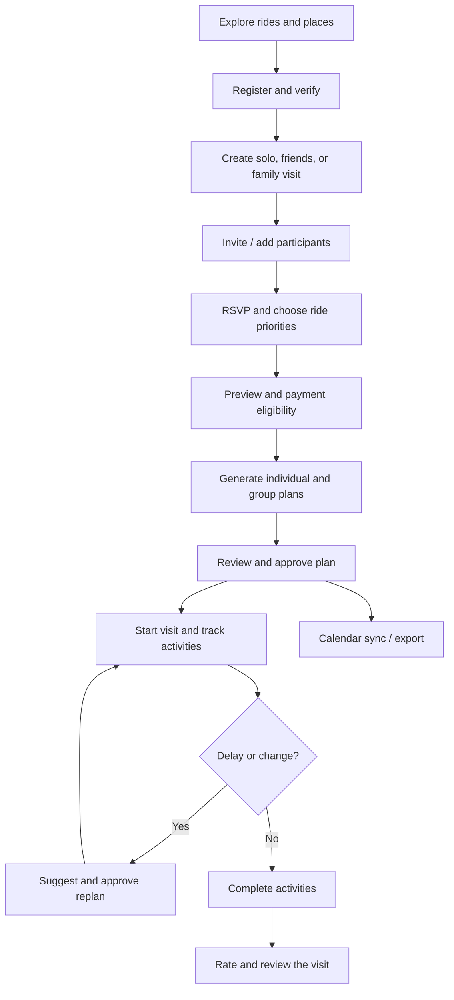
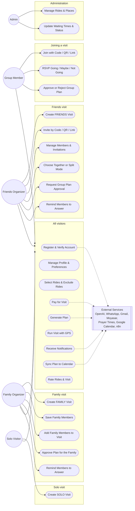
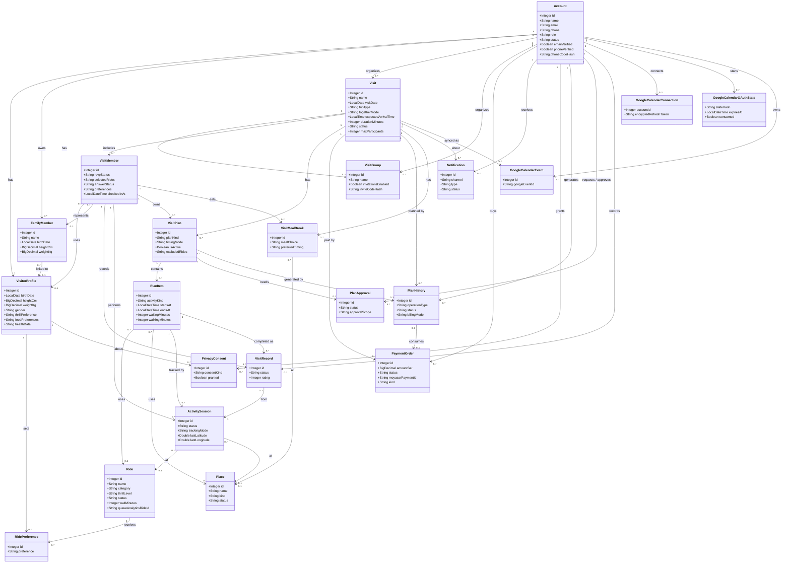
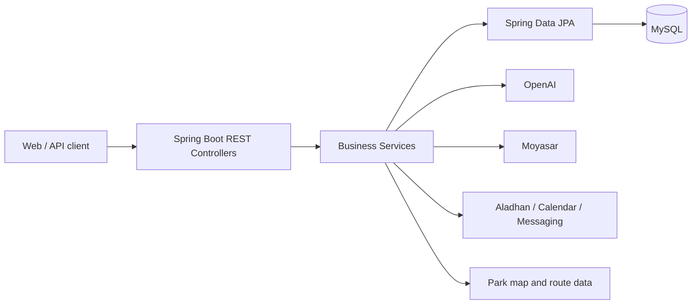
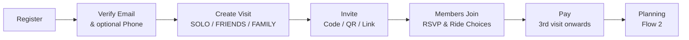

<div align="center">


# SIKKA | سكة 🎢

### Your Qiddiya day, planned in minutes.

**An AI-powered visit planner for Six Flags Qiddiya — built for solo visitors, friends, and families.**

[](https://www.java.com/)
[](https://spring.io/projects/spring-boot)
[](https://www.mysql.com/)
[](https://railway.com/)

[Overview](#overview) · [Features](#features) · [User Journey](#user-journey) · [Architecture](#architecture) · [API Overview](#api-overview) · [Contributions](#mohammed-turki-contributions) · [Flow 1](#flow-1-accounts-visits--invitations-mohammed-turki)

</div>

---

## Overview

**SIKKA (سكة)** helps visitors organize a full day at **Six Flags Qiddiya**. Instead of managing ride choices, queue times, walking distances, meals, and group decisions in separate places, Sikka brings them together in a coordinated visit plan.

The organizer creates a visit; friends or family participate and select rides; the backend checks ride restrictions; AI assists with individual and group itineraries; and the app supports approvals, progress tracking, GPS-assisted activities, alerts, and post-visit ratings.

> **Scope:** Sikka plans park visits. It does **not** sell Six Flags admission tickets. Paid functionality refers to Sikka's planning service.

## The Problem & Our Solution

| Visitor challenge | Sikka's approach |
|---|---|
| Different interests and ride restrictions | Personal profiles, ride priorities, and eligibility checks |
| Difficult group coordination | Solo, friends, and family visits; invitations and participant management |
| Time lost to queues and walking | Itineraries informed by available waiting-time and map data |
| Meal and prayer breaks are overlooked | Scheduled dining breaks and prayer times |
| Schedules become outdated during the visit | Completion tracking, delays, and proposed replanning |
| Hard to recall what was completed | Per-member records, ratings, and progress summaries |

## Technology Stack

| Layer | Technologies / integrations |
|---|---|
| Backend | Java 17, Spring Boot 4.1.1, REST controllers |
| Persistence | MySQL 8, Spring Data JPA / Hibernate |
| Authentication | Spring Security, session authentication, BCrypt |
| AI planning | OpenAI API, server-side itinerary validation |
| Park data & maps | Ride / place catalogue, park map and walking routes |
| Prayer times | Aladhan API |
| Payments | Moyasar sandbox, backend-side payment verification |
| Communication | Gmail SMTP, UltraMsg WhatsApp, n8n webhooks |
| Calendar | Google Calendar OAuth, manual Google link, Apple `.ics` export |
| QR invitations | ZXing |
| Frontend (separate repository) | Next.js 16, React 19, TypeScript, Tailwind CSS |
| Testing & delivery | JUnit, Mockito, Maven Wrapper, Docker, GitHub Actions, Railway |

**Repository scope:** This repository contains the Spring Boot backend. Do not assume a React frontend is included in this repository or that every external integration is live in production.

## External APIs & Integrations

| Service | Purpose | Implementation area |
|---|---|---|
| OpenAI API | AI-assisted individual/group plans and replanning | Planning services |
| Aladhan API | Prayer time lookup for scheduling | `PrayerTimeService` |
| Google Calendar API | OAuth connection and synchronization of approved plans | Calendar services |
| Gmail SMTP | Email verification and account messages | Email services |
| UltraMsg (WhatsApp) | Phone verification and messages | WhatsApp services |
| Moyasar API | Server-side payment confirmation | `MoyasarService` |
| n8n webhooks | Workflow-driven notification delivery | `N8nNotificationService` |

Apple Calendar `.ics` exports, ZXing QR generation, browser GPS and local park routing are **not separate external REST API providers**. Provider setup and actual live delivery depend on credentials and deployment configuration.

## Features

### Accounts, profiles and group visits
- Account registration, email and optional phone verification, password recovery, authenticated profile management.
- Visit types: `SOLO`, `FRIENDS`, and `FAMILY`.
- Invitations through a code, QR code, or shareable link; RSVP and selected ride priorities.
- Family member profiles managed by the visit organizer.
- Free-visit allowance and server-verified payment for additional planning.

### AI-assisted planning
- Individual and coordinated group itineraries.
- Three ride priorities: `MUST_RIDE`, `PREFERRED`, `OPTIONAL`.
- Eligibility and itinerary constraints evaluated by the backend — AI output is not a substitute for official ride safety rules.
- Ride availability, waiting times, walking routes, meals, snacks, and prayer-time considerations.
- Plan approval, subgroup coordination, meeting points, and proposed replanning.

### During and after the visit
- Activity sessions started manually or through GPS-assisted flows.
- Family activity completion and per-member visit records.
- Delay notifications, current / next activities, and visit progress.
- Optional ratings and reviews for completed experiences.
- Calendar synchronization and export.

## User Journey


## Use Case Diagram

Sikka has three visit types, so the actors are separated by the type of visit they run.



| Actor | Visit type | What is different |
|---|---|---|
| **Solo Visitor** | SOLO | No group and no invitations; one individual plan |
| **Family Organizer** | FAMILY | Adds saved family members (children and adults) to the visit, chooses the rides for the family, reminds members to answer, and approves the plan for them |
| **Friends Organizer** | FRIENDS | Creates the group, invites by code / QR / link, chooses together or split mode, reminds members to answer, requests group approval |
| **Group Member** | FRIENDS / FAMILY | Joins an existing visit, answers RSVP, selects rides, approves or rejects plans |
| **Admin** | None | Manages the ride and place catalogue |

---

## Class Diagram

The diagram shows the **22 entities** of Sikka (key fields only) and their relationships, taken from the JPA mappings in the `Model/` package.



---

## Architecture



The Java code follows the project structure:

```text
src/main/java/com/example/sikka/
├── Advice/       # Exception handling
├── Api/          # Common API response / exception
├── Config/       # Security and configuration
├── Controller/   # REST endpoints
├── DtoIn/        # Request DTOs
├── DtoOut/       # Response DTOs
├── Model/        # JPA entities
├── Repository/   # Database access
└── Service/      # Business logic and integrations
```

## API Overview

The backend currently declares **170 REST endpoints across 22 controllers** on the GitHub `main` branch (28 October 2026). These are source-code route counts, not a claim that every external integration has passed live end-to-end testing.

**Contribution accounting:** Each Model belongs to its original Git creator. Each API endpoint is credited to the developer who first implemented that route, even when it appears in another team member's Controller. Subsequent shared fixes and integrations are listed separately; contributor-specific endpoint totals will be published only after the route-level Git audit is complete.

## Data Model

The project currently contains **22 JPA models** across the following areas.

The project contains core models for visitors, visits, plans, park facilities, payments, messaging, and calendar sync. Examples include:

| Domain | Models |
|---|---|
| Users & visits | `Account`, `VisitorProfile`, `FamilyMember`, `Visit`, `VisitGroup`, `VisitMember` |
| Planning | `VisitPlan`, `PlanItem`, `PlanApproval`, `PlanHistory`, `VisitMealBreak` |
| Live execution | `ActivitySession`, `VisitRecord`, `Notification` |
| Park & billing | `Ride`, `Place`, `RidePreference`, `PaymentOrder`, `PrivacyConsent` |
| Calendar integration | `GoogleCalendarConnection`, `GoogleCalendarEvent`, `GoogleCalendarOAuthState` |

The current model inventory extends beyond the original **15-model team allocation**. Always use the `Model/` package for the current entity inventory rather than relying on the older ERD alone.


**Important:** The counts below are grouped by the original Model creator / Controller domain. This does not establish per-person authorship of every route; a route belongs to whoever first introduced it in Git. Such individual counts are not yet fully audited.

## Mohammed Turki Contributions

**Core entities:** Account, VisitorProfile, VisitGroup, Visit, VisitMember. FamilyMember workflows are used in this flow, but Nawaf originally created that Model.

**Main work:** registration and account/profile management, email and phone verification, password recovery, individual/friends/family visit creation, group invitations, RSVP, ride selections, visit preview, check-in, and visit lifecycle management.

**Integrations:** Gmail SMTP for email verification, UltraMsg for WhatsApp verification and ZXing for invitation QR codes. The before-visit workflow uses verified payment status supplied by the payment module.

**Additional contributions:** session-security configuration, account and visit validation, frontend-facing visit contracts, and flow-level tests. Work shared across modules is not independently attributed here.


**Controller-domain inventory:** 6 controllers and 59 endpoints in the current `main` branch. This is not a personal-code-credit count.

**Shared work note:** Several visit and member endpoints were introduced by Abdulaziz in Controllers associated with Mohammed’s models. Model ownership is kept separate from endpoint authorship.

---

## Flow 1: Accounts, Visits & Invitations (Mohammed Turki)

### 1. Flow Brief

Flow 1 covers everything before the plan exists: the account and its security, the visit, the group, and the members.

A user registers, verifies the **email** (code sent by email) and optionally the **phone** (code sent by WhatsApp), then creates a **visit**. The organizer invites others by **code, QR, or link**. Members join, answer RSVP, and choose rides. When planning starts, the first two visits are free and later visits are paid through **Moyasar**.



### 2. Models and Relationships

| Model | Key fields | Relationships |
|---|---|---|
| **Account** | name, email, phone, passwordHash, role, status, emailVerified, phoneVerified, hashed verification codes | One-to-one `VisitorProfile`; one-to-many `Visit`, `VisitGroup`, `FamilyMember` |
| **VisitorProfile** | birthDate, heightCm, weightKg, gender, thrillPreference, foodPreferences, healthData | One-to-one `Account` |
| **VisitGroup** | name, invitationsEnabled, inviteCodeHash | Many-to-one organizer `Account`; one-to-one `Visit` |
| **Visit** | name, visitDate, expected arrival, planned start/end, tripType, togetherMode, goals, status, maxParticipants | Many-to-one organizer `Account`; one-to-many `VisitMember`, `VisitPlan` |
| **VisitMember** | rsvpStatus, selectedRides, preferences (including excluded rides and ride types), answerStatus, age/height/weight snapshot, ratings | Many-to-one `Visit`; links to `VisitorProfile` or `FamilyMember` |

`FamilyMember` is used in this flow (adding saved family members to a visit), but its model and CRUD endpoints belong to Nawaf's flow.

**Business rules**

- **Verification:**
  - Email and phone are verified **separately**: the email code goes to the email and the phone code goes to WhatsApp.
  - Codes have 6 digits, are stored as **SHA-256 hashes**, are valid for 10 minutes, and have a 1-minute resend cooldown.
  - The email is required and is the login name; the phone is optional.
  - A confirmation message is sent after each successful verification.
  - Password reset is sent by WhatsApp when the phone is verified, otherwise by email.
- **Verified gate:** an account with an unverified email cannot create or join a visit.
- **Invitations:** one hashed group code is shared by three methods (code, QR PNG, link). Only the organizer can regenerate the code, turn invitations on or off, or get the QR and link.
- **Joining:** blocked when invitations are off, the code is wrong, the visit is full or cancelled, or the user already joined.
- **Together visits:** ride choices are copied from the organizer when a member confirms GOING or is added as family. In FRIENDS/FAMILY visits that are not split, only the organizer chooses rides.
- **Excluded rides:** a member can exclude specific rides or ride types (`THRILL`, `FAMILY`, `KIDS`, `WATER`, `ARCADE`); an excluded ride cannot also be selected.
- **Capacity:** when the organizer adds saved family members and the visit is too small, the request can raise `maxParticipants`; duplicates are skipped.
- **Park hours:** visit create, update, and start validate the visit date and time against the park operating hours.
- **Editing:** visit details can be changed until the plan is generated; before the first plan exists, a visit goes back to DRAFT so the organizer can edit it.
- **Reminders:** the organizer can remind a member who has not answered yet (DRAFT visits only).
- **Pricing:** the first 2 planned visits of an account are free; from the 3rd visit the organizer pays **19 SAR (SOLO)** or **29 SAR (FRIENDS / FAMILY)**. One payment covers all planning of that visit, including re-generation.
- **Payment safety:** the frontend result is never trusted. The server fetches the payment from Moyasar with the secret key and checks status, amount, currency, order id, and that the payment id was not used before.

### 3. CRUD Endpoints

Create, read, update, and delete endpoints for the Flow 1 models. They are restricted to the `ADMIN` role.

| Model | Method | Endpoint | Description |
|---|---|---|---|
| Account | GET | `/api/v1/account/get` | All accounts |
| Account | POST | `/api/v1/account/add` | Add account |
| Account | PUT | `/api/v1/account/update/{id}` | Update account |
| Account | DELETE | `/api/v1/account/delete/{id}` | Delete account |
| VisitorProfile | GET | `/api/v1/visitor-profile/get` | All profiles |
| VisitorProfile | POST | `/api/v1/visitor-profile/add` | Add profile |
| VisitorProfile | PUT | `/api/v1/visitor-profile/update/{id}` | Update profile |
| VisitorProfile | DELETE | `/api/v1/visitor-profile/delete/{id}` | Delete profile |
| VisitGroup | GET | `/api/v1/visit-group/get` | All groups |
| VisitGroup | POST | `/api/v1/visit-group/add` | Add group |
| VisitGroup | PUT | `/api/v1/visit-group/update/{id}` | Update group |
| VisitGroup | DELETE | `/api/v1/visit-group/delete/{id}` | Delete group |
| Visit | GET | `/api/v1/visit/get` | All visits |
| Visit | POST | `/api/v1/visit/add` | Add visit |
| Visit | PUT | `/api/v1/visit/update/{id}` | Update visit |
| Visit | DELETE | `/api/v1/visit/delete/{id}` | Delete visit |
| VisitMember | GET | `/api/v1/visit-member/get` | All members |
| VisitMember | POST | `/api/v1/visit-member/add` | Add member |
| VisitMember | DELETE | `/api/v1/visit-member/delete/{id}` | Delete member |

### 4. Extra Endpoints

**Account and security**

| Method | Endpoint | Description |
|---|---|---|
| POST | `/api/v1/account/register` | Register an account and visitor profile, then send verification codes |
| GET | `/api/v1/account/me` | Current account (no password) |
| POST | `/api/v1/auth/verify-email` | Verify the email with the code |
| POST | `/api/v1/auth/resend-verification` | Resend the email code |
| POST | `/api/v1/auth/verify-phone` | Verify the phone with the WhatsApp code |
| POST | `/api/v1/auth/resend-phone-verification` | Resend the phone code |
| POST | `/api/v1/auth/forgot-password` | Send a reset code |
| POST | `/api/v1/auth/reset-password` | Set a new password with the code |
| GET | `/api/v1/visitor-profile/my-profile` | My profile |
| PUT | `/api/v1/visitor-profile/update-my-profile` | Update my profile |

**Visits**

| Method | Endpoint | Description |
|---|---|---|
| POST | `/api/v1/visit/create` | Create a visit (and its group for FRIENDS / FAMILY) |
| GET | `/api/v1/visit/my-visits` | My visits |
| GET | `/api/v1/visit/details/{visitId}` | Visit details |
| PUT | `/api/v1/visit/update-visit/{visitId}` | Update a visit |
| PUT | `/api/v1/visit/cancel/{visitId}` | Cancel a visit |
| GET | `/api/v1/visit/preview/{visitId}` | Preview before planning |
| PUT | `/api/v1/visit/arrival/{visitId}` | Set the expected arrival time (and meal preferences) |
| PUT | `/api/v1/visit/start/{visitId}` | Start the visit (needs a plan) |
| PUT | `/api/v1/visit/complete/{visitId}` | Complete the visit |
| POST | `/api/v1/visit/reuse/{sourceVisitId}` | Reuse an earlier visit |

**Groups and invitations**

| Method | Endpoint | Description |
|---|---|---|
| POST | `/api/v1/visit-group/add-group/{visitId}` | Add a group to a visit |
| PUT | `/api/v1/visit-group/regenerate-code/{visitId}` | Create a new invite code |
| PUT | `/api/v1/visit-group/toggle-invitations/{visitId}` | Turn invitations on or off |
| GET | `/api/v1/visit-group/qr/{visitId}?code=` | Invite QR code (PNG) |
| GET | `/api/v1/visit-group/link/{visitId}?code=` | Shareable invite link |

**Members**

| Method | Endpoint | Description |
|---|---|---|
| POST | `/api/v1/visit-member/join` | Join a visit with the code |
| PUT | `/api/v1/visit-member/rsvp/going/{visitId}` | RSVP going |
| PUT | `/api/v1/visit-member/rsvp/maybe/{visitId}` | RSVP maybe |
| PUT | `/api/v1/visit-member/rsvp/not-going/{visitId}` | RSVP not going |
| PUT | `/api/v1/visit-member/update-selected-rides/{visitId}` | Select rides |
| GET | `/api/v1/visit-member/preferences/{visitMemberId}` | Read saved ride choices and exclusions |
| PUT | `/api/v1/visit-member/preferences/{visitMemberId}` | Save ride choices, disliked features, and exclusions |
| PUT | `/api/v1/visit-member/preferences/skip/{visitMemberId}` | Skip preferences |
| POST | `/api/v1/visit-member/add-family/{visitId}` | Add saved family members to the visit |
| POST | `/api/v1/visit-member/remind/{memberId}` | Organizer reminds a member to answer |
| GET | `/api/v1/visit-member/summary/{visitId}` | Members summary |
| PUT | `/api/v1/visit-member/check-in/{visitId}` | Check in at the park |
| PUT | `/api/v1/visit-member/review/{visitId}` | Review the visit |
| DELETE | `/api/v1/visit-member/leave/{visitId}` | Leave the visit |
| DELETE | `/api/v1/visit-member/remove/{visitId}/{memberId}` | Organizer removes a member |

**Payment confirmation (shared with the payment module)**

| Method | Endpoint | Description |
|---|---|---|
| POST | `/api/v1/payment-order/confirm/{paymentOrderId}` | Verify a Moyasar payment on the server and mark the order PAID or FAILED |

### 5. External APIs and Technologies

| Service | Used for | Where |
|---|---|---|
| **Gmail SMTP** | Email verification, password reset, confirmation messages | `EmailService` |
| **UltraMsg (WhatsApp)** | Phone verification codes and short messages | `WhatsAppService` |
| **Moyasar** | Payment verification (`GET /v1/payments/{id}`, Basic auth with the secret key) | `MoyasarService` |
| **ZXing** | Invitation QR code generation | `VisitGroupService` |
| **Spring Security** | Session login (HTTP-only cookie) and Basic Auth for API clients, BCrypt, role-based access, JSON 401 / 403 | `SecurityConfig` |

Email and WhatsApp failures never break the request; they are only logged.

### 6. Automated Tests (Flow 1)

| Layer | Test class | What it checks |
|---|---|---|
| Repository (`@DataJpaTest`, H2) | `AccountRepositoryTest` | Find an account by email (found and unknown) |
| Repository | `RideRepositoryTest` | Find by status, by source ride id, name exists (ignore case), filter rides |
| Repository | `VisitGroupRepositoryTest` | Visit group queries |
| Repository | `FamilyMemberRepositoryTest` | Family member queries |
| Repository | `PaymentOrderRepositoryTest` | Payment order queries |
| Service (Mockito) | `AccountServiceTest` | Duplicate email is rejected and nothing is saved; a new account is saved as USER, unverified, with an encoded password |
| Service | `VerificationServiceTest` | A wrong code is rejected; the correct code verifies the email, clears the hash, and sends the confirmation |
| Service | `VisitMemberServiceTest` | Joining with an unverified account, or when invitations are disabled, is rejected |
| Service | `VisitServiceTest` | Creating a visit fails for an unknown account, an unverified account, or a past date |
| Service | `PaymentOrderServiceTest` | Unknown order, another user's order, a paid payment (marks PAID), and a wrong amount (stays PENDING) |
| Controller (`@WebMvcTest`) | `AuthControllerTest` | Verify email: success, bad code format (400), wrong code (400) |
| Controller | `AccountControllerTest` | Register: success, short password (400), duplicate email (400) |
| Controller | `RideControllerTest` | Get rides, ride not found, add ride, blank name (400) |
| Controller | `PlaceControllerTest` | Get places, place not found, blank name (400), delete |
| Controller | `MapControllerTest` | Map rides, route, bad id type (400), route failure (400) |

Repository tests run on H2 in MySQL mode. Controller tests mock the service layer and turn the security filters off, so they check only the HTTP contract and validation.

---

<div align="center">

**SIKKA | سكة** · Your Qiddiya day, planned in minutes.

</div>
