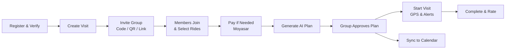
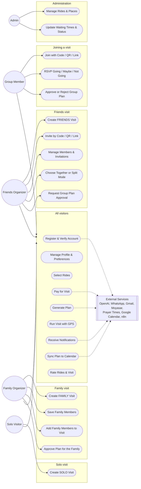
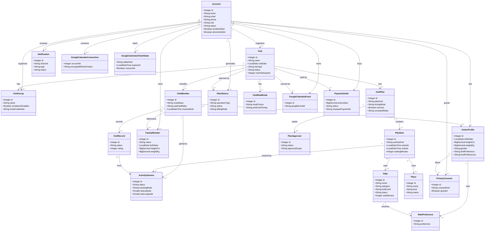
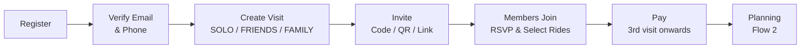
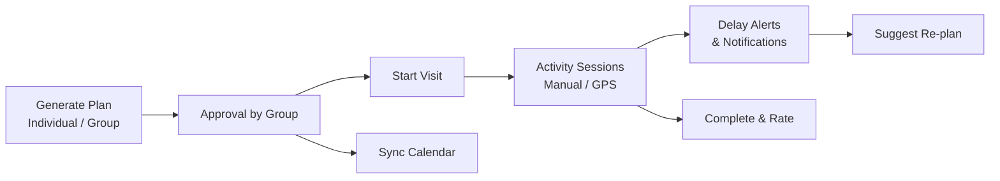
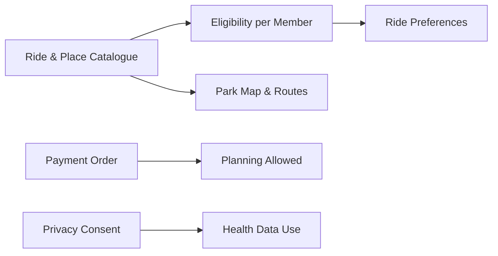

<div align="center">


# Sikka | سكة

### Your Qiddiya day, planned in minutes. 🎢

**Sikka** is a group visit-planning platform for **Six Flags Qiddiya**. It helps a group of friends, a family, or a solo visitor plan one full park day: who is coming, which rides suit everyone, and a time-boxed plan that follows the group live during the visit.

</div>

---

## Project Brief

**Sikka** (سكة) turns a theme-park visit into an organized, shared plan.

An organizer creates a visit and invites the group. Each member shares their preferences and selected rides. The system checks every ride against the member's age, height, weight, and health rules, then uses AI to generate a daily plan with ride order, waiting times, walking time, meal breaks, and prayer times. During the visit, GPS tracking and alerts keep the plan on track, and the approved plan can be synced to the user's calendar.

Sikka is a **planning and assistance platform**. It does not sell park tickets.

---

## Problem

Visiting a large theme park with a group is hard to organize:

- Everyone wants different rides, and ride rules (height, age, health) differ per person.
- Families with children need to know who can ride what, and who must accompany whom.
- Long queues, walking distance, meals, and prayer times are not planned, so time is wasted.
- Groups split up and lose each other during the day.
- Plans made in chat apps are not updated when waiting times or ride status change.

---

## Solution

Sikka brings the whole visit into one platform:

- Create a visit and invite the group by **code, QR, or link**.
- Collect every member's profile, preferences, and ride choices.
- Check **ride eligibility** per member (age, height, weight, health).
- Generate an **AI plan** (individual or group) with approval by the group.
- Include **meal breaks and prayer times** in the schedule.
- Track the visit live with **GPS**, detect delays, and suggest a new plan.
- Sync approved plans to **Google Calendar** (or export to Apple Calendar).
- Send **in-app, WhatsApp, and Email notifications** through n8n workflows.
- First 2 visits are free; later visits are paid through **Moyasar**.

---

## Main Features

- Account registration with **separate email and phone verification** (email by Gmail, phone by WhatsApp).
- Session-based security with **Spring Security** and role-based access (USER / ADMIN).
- Visits of three types: **SOLO, FRIENDS, FAMILY** with group, members, and saved family members.
- Three invitation methods: **invite code, QR code, shareable link**.
- Ride catalogue with eligibility rules and live waiting times.
- AI-generated **individual and group plans**, approval flow, and re-planning.
- Live visit execution: check-in, activity sessions, GPS, delay alerts.
- Server-side selection of rides (must-ride rides, feasible subsets, excluded rides with reasons) before and after the AI plan.
- Plan route on the park map with walking paths between activities.
- **Google Calendar** sync (OAuth), plus Apple Calendar file and manual link.
- Notification events (plan ready, approval, replan, reminders, payment) delivered in-app and by n8n.
- Payment per visit with **Moyasar** and server-side verification.
- Privacy consent management for sensitive data.

---

## Core User Flow



---

## Use Case Diagram

Sikka has three visit types, so the actors are separated by the type of visit they run.



| Actor | Visit type | What is different |
|---|---|---|
| **Solo Visitor** | SOLO | No group and no invitations; one individual plan |
| **Family Organizer** | FAMILY | Adds saved family members (children and adults) to the visit and approves the plan for them |
| **Friends Organizer** | FRIENDS | Creates the group, invites by code / QR / link, chooses together or split mode, requests group approval |
| **Group Member** | FRIENDS / FAMILY | Joins an existing visit, answers RSVP, selects rides, approves or rejects plans |
| **Admin** | None | Manages the ride and place catalogue |

---

## Class Diagram

The diagram shows the **22 entities** of Sikka (key fields only) and their relationships.



---

## Technology Stack

| Area | Technology |
|---|---|
| Language / Framework | Java 17, Spring Boot 4.1 |
| Database | MySQL 8 (Spring Data JPA / Hibernate) |
| Security | Spring Security (session + Basic), BCrypt |
| AI | OpenAI API (plan generation) |
| Payment | Moyasar (sandbox) |
| Messaging | Gmail SMTP (Email), UltraMsg (WhatsApp), n8n (notification workflows) |
| Calendar | Google Calendar API (OAuth 2.0), Apple Calendar (.ics) |
| Prayer times | Aladhan API |
| DevOps | Docker, Railway, GitHub Actions (CI with MySQL) |
| Other | ZXing (QR codes), Postman, JUnit 5, Mockito |

---

## Flow 1: Accounts, Visits & Invitations (Mohammed Turki)

### 1. Flow Brief

Flow 1 covers everything before the plan exists: the user account and its security, the visit, the group, and the members.

A user registers, verifies the **email** (code by email) and optionally the **phone** (code by WhatsApp), then creates a **visit**. The organizer invites others by **code, QR, or link**. Members join, answer RSVP, and select rides. When planning starts, the first two visits are free and later visits are paid through **Moyasar**.



### 2. Models and Relationships

| Model | Key fields | Relationships |
|---|---|---|
| **Account** | name, email, phone, passwordHash, role, status, emailVerified, phoneVerified, verification codes (hashed) | One-to-one `VisitorProfile`; one-to-many `Visit`, `VisitGroup`, `FamilyMember` |
| **VisitorProfile** | birthDate, heightCm, weightKg, gender, thrillPreference, foodPreferences, healthData | One-to-one `Account` |
| **VisitGroup** | name, invitationsEnabled, inviteCodeHash | Many-to-one organizer `Account`; one-to-one `Visit` |
| **Visit** | name, visitDate, planned start/end, tripType, togetherMode, goals, status, maxParticipants | Many-to-one organizer `Account`; one-to-many `VisitMember`, `VisitPlan` |
| **VisitMember** | rsvpStatus, selectedRides, snapshot of age/height/weight, ratings | Many-to-one `Visit`; links to `VisitorProfile` or `FamilyMember` |
| **FamilyMember** | name, birthDate, heightCm, weightKg, gender | Many-to-one owner `Account` |

**Business rules**

- **Verification:**
  - Email and phone are verified **separately**; the email code goes to the email and the phone code goes to WhatsApp.
  - Codes are 6 digits, stored as **SHA-256 hashes**, valid for 10 minutes, with a 1-minute resend cooldown.
  - The phone is optional; the email is required and is the login name.
  - A confirmation message is sent after each successful verification.
- **Verified gate:** an account with an unverified email cannot create or join a visit.
- **Invitations:** one hashed group code is shared by three methods (code, QR PNG, link). Only the organizer can regenerate the code, turn invitations on or off, or get the QR and link.
- **Joining:** blocked when invitations are off, the code is wrong, the visit is full or cancelled, or the user already joined.
- **Pricing:** the first 2 planned visits of an account are free; from the 3rd visit the organizer pays **19 SAR (SOLO)** or **29 SAR (FRIENDS / FAMILY)**. One payment covers all planning of that visit, including re-generation.
- **Payment safety:** the frontend result is never trusted. The server fetches the payment from Moyasar with the secret key and checks status, amount, currency, order id, and that the payment id was not used before.

### 3. CRUD Endpoints

| Model | Method | Endpoint | Description |
|---|---|---|---|
| Account | GET | `/api/v1/account/get` | All accounts (admin) |
| Account | POST | `/api/v1/account/add` | Add account (admin) |
| Account | PUT | `/api/v1/account/update/{id}` | Update account (admin) |
| Account | DELETE | `/api/v1/account/delete/{id}` | Delete account (admin) |
| VisitorProfile | GET | `/api/v1/visitor-profile/get` | All profiles (admin) |
| VisitorProfile | POST | `/api/v1/visitor-profile/add` | Add profile (admin) |
| VisitorProfile | PUT | `/api/v1/visitor-profile/update/{id}` | Update profile (admin) |
| VisitorProfile | DELETE | `/api/v1/visitor-profile/delete/{id}` | Delete profile (admin) |
| VisitGroup | GET | `/api/v1/visit-group/get` | All groups (admin) |
| VisitGroup | POST | `/api/v1/visit-group/add` | Add group (admin) |
| VisitGroup | PUT | `/api/v1/visit-group/update/{id}` | Update group (admin) |
| VisitGroup | DELETE | `/api/v1/visit-group/delete/{id}` | Delete group (admin) |
| Visit | GET | `/api/v1/visit/get` | All visits (admin) |
| Visit | POST | `/api/v1/visit/add` | Add visit (admin) |
| Visit | PUT | `/api/v1/visit/update/{id}` | Update visit (admin) |
| Visit | DELETE | `/api/v1/visit/delete/{id}` | Delete visit (admin) |
| VisitMember | GET | `/api/v1/visit-member/get` | All members (admin) |
| VisitMember | POST | `/api/v1/visit-member/add` | Add member (admin) |
| VisitMember | DELETE | `/api/v1/visit-member/delete/{id}` | Delete member (admin) |
| FamilyMember | GET | `/api/v1/family-member/get/my` | My saved family members |
| FamilyMember | GET | `/api/v1/family-member/get/details/{familyMemberId}` | One family member |
| FamilyMember | POST | `/api/v1/family-member/add` | Add a family member |
| FamilyMember | PUT | `/api/v1/family-member/update/{familyMemberId}` | Update a family member |
| FamilyMember | DELETE | `/api/v1/family-member/delete/{familyMemberId}` | Delete a family member |

### 4. Extra Endpoints

**Account and security**

| Method | Endpoint | Description |
|---|---|---|
| POST | `/api/v1/account/register` | Register account and visitor profile, then send verification codes |
| GET | `/api/v1/account/me` | Current account (no password) |
| POST | `/api/v1/auth/verify-email` | Verify the email with the code |
| POST | `/api/v1/auth/resend-verification` | Resend the email code |
| POST | `/api/v1/auth/verify-phone` | Verify the phone with the WhatsApp code |
| POST | `/api/v1/auth/resend-phone-verification` | Resend the phone code |
| POST | `/api/v1/auth/forgot-password` | Send a reset code (WhatsApp if phone verified, otherwise email) |
| POST | `/api/v1/auth/reset-password` | Set a new password with the code |
| GET | `/api/v1/visitor-profile/my-profile` | My profile |
| PUT | `/api/v1/visitor-profile/update-my-profile` | Update my profile |

**Visits**

| Method | Endpoint | Description |
|---|---|---|
| POST | `/api/v1/visit/create` | Create a visit (and its group for FRIENDS / FAMILY) |
| GET | `/api/v1/visit/my-visits` | My visits |
| GET | `/api/v1/visit/details/{visitId}` | Visit details |
| PUT | `/api/v1/visit/update-visit/{visitId}` | Update a visit |
| PUT | `/api/v1/visit/cancel/{visitId}` | Cancel a visit |
| GET | `/api/v1/visit/preview/{visitId}` | Preview before planning |
| PUT | `/api/v1/visit/arrival/{visitId}` | Set expected arrival time |
| PUT | `/api/v1/visit/start/{visitId}` | Start the visit (needs a plan) |
| PUT | `/api/v1/visit/complete/{visitId}` | Complete the visit |
| POST | `/api/v1/visit/reuse/{sourceVisitId}` | Reuse an earlier visit |

**Groups and invitations**

| Method | Endpoint | Description |
|---|---|---|
| POST | `/api/v1/visit-group/add-group/{visitId}` | Add a group to a visit |
| PUT | `/api/v1/visit-group/regenerate-code/{visitId}` | Create a new invite code |
| PUT | `/api/v1/visit-group/toggle-invitations/{visitId}` | Turn invitations on or off |
| GET | `/api/v1/visit-group/qr/{visitId}?code=` | Invite QR code (PNG) |
| GET | `/api/v1/visit-group/link/{visitId}?code=` | Shareable invite link |

**Members**

| Method | Endpoint | Description |
|---|---|---|
| POST | `/api/v1/visit-member/join` | Join a visit with the code |
| PUT | `/api/v1/visit-member/rsvp/going/{visitId}` | RSVP going |
| PUT | `/api/v1/visit-member/rsvp/maybe/{visitId}` | RSVP maybe |
| PUT | `/api/v1/visit-member/rsvp/not-going/{visitId}` | RSVP not going |
| PUT | `/api/v1/visit-member/update-selected-rides/{visitId}` | Select rides |
| PUT | `/api/v1/visit-member/preferences/{visitMemberId}` | Set member preferences |
| PUT | `/api/v1/visit-member/preferences/skip/{visitMemberId}` | Skip preferences |
| POST | `/api/v1/visit-member/add-family/{visitId}` | Add saved family members to the visit |
| GET | `/api/v1/visit-member/summary/{visitId}` | Members summary |
| PUT | `/api/v1/visit-member/check-in/{visitId}` | Check in at the park |
| PUT | `/api/v1/visit-member/review/{visitId}` | Review the visit |
| DELETE | `/api/v1/visit-member/leave/{visitId}` | Leave the visit |
| DELETE | `/api/v1/visit-member/remove/{visitId}/{memberId}` | Organizer removes a member |

**Payment confirmation**

| Method | Endpoint | Description |
|---|---|---|
| POST | `/api/v1/payment-order/confirm/{paymentOrderId}` | Verify a Moyasar payment on the server and mark the order PAID or FAILED |

### 5. External APIs and Technologies

| Service | Used for | Where |
|---|---|---|
| **Gmail SMTP** | Email verification, password reset, confirmation messages | `EmailService` |
| **UltraMsg (WhatsApp)** | Phone verification codes and short messages | `WhatsAppService` |
| **Moyasar** | Payment verification (`GET /v1/payments/{id}`, Basic auth with the secret key) | `MoyasarService` |
| **ZXing** | QR code generation | `VisitGroupService` |
| **Spring Security** | Session login (HTTP-only cookie) and Basic Auth for API clients, BCrypt, role-based access, JSON 401 / 403 | `SecurityConfig` |

Email and WhatsApp failures never break the request; they are only logged.

### 6. Automated Tests (Flow 1)

| Layer | Test class | What it checks |
|---|---|---|
| Repository (`@DataJpaTest`, H2) | `AccountRepositoryTest` | Find an account by email (found and unknown) |
| Repository | `RideRepositoryTest` | Find by status, by source ride id, name exists (ignore case), filter rides |
| Repository | `VisitGroupRepositoryTest` | Visit group queries |
| Repository | `FamilyMemberRepositoryTest` | Family member queries |
| Repository | `PaymentOrderRepositoryTest` | Payment order queries |
| Service (Mockito) | `AccountServiceTest` | Duplicate email is rejected and nothing is saved; a new account is saved as USER, unverified, with an encoded password |
| Service | `VerificationServiceTest` | A wrong code is rejected; the correct code verifies the email, clears the hash, and sends the confirmation |
| Service | `VisitMemberServiceTest` | Joining with an unverified account, or when invitations are disabled, is rejected |
| Service | `VisitServiceTest` | Creating a visit fails for an unknown account, an unverified account, or a past date |
| Service | `PaymentOrderServiceTest` | Unknown order, another user's order, a paid payment (marks PAID), and a wrong amount (stays PENDING) |
| Controller (`@WebMvcTest`) | `AuthControllerTest` | Verify email: success, bad code format (400), wrong code (400) |
| Controller | `AccountControllerTest` | Register: success, short password (400), duplicate email (400) |
| Controller | `RideControllerTest` | Get rides, ride not found, add ride, blank name (400) |
| Controller | `PlaceControllerTest` | Get places, place not found, blank name (400), delete |
| Controller | `MapControllerTest` | Map rides, route, bad id type (400), route failure (400) |

Repository tests run on H2 in MySQL mode (`spring.test.database.replace=none`). Controller tests mock the service layer and turn the security filters off, so only the HTTP contract and validation are tested.

---

## Flow 2: Planning & Live Visit (Abdulaziz)

> Drafted from the code. Abdulaziz: please review and edit.

### 1. Flow Brief

Flow 2 turns the group's choices into a plan and follows it during the visit. The AI builds an **individual** or **group plan** (rides, waiting and walking time, meal breaks, prayer times). The server first selects the rides (must-ride rides, feasible subsets, excluded rides with reasons), the group **approves** the plan, and the visit then runs with **activity sessions**, **GPS location**, **delay alerts**, **re-planning suggestions**, **calendar sync**, and **notifications**.



### 2. Models

| Model | Purpose |
|---|---|
| **VisitPlan** | A plan of a visit (individual or group, active or pending proposal) |
| **PlanItem** | One activity in a plan (ride, meal, prayer, walk) with timing |
| **PlanApproval** | Approval of a group plan |
| **PlanHistory** | Record of each generation for billing and quota |
| **VisitRecord** | Completed or skipped activity with a rating |
| **ActivitySession** | Live session of an activity with GPS data |
| **VisitMealBreak** | Meal break choices of the group |
| **Notification** | Alerts and messages sent to users (in-app, forwarded to WhatsApp / Email by n8n) |
| **GoogleCalendarConnection** | Encrypted Google refresh token of an account |
| **GoogleCalendarEvent** | Link between a visit and its Google event |
| **GoogleCalendarOAuthState** | One-time state used in the Google OAuth flow |

### 3. CRUD Endpoints

| Model | Method | Endpoint | Description |
|---|---|---|---|
| VisitPlan | GET | `/api/v1/visit-plan/get/plans/{visitId}` | Plans of a visit |
| VisitPlan | GET | `/api/v1/visit-plan/get/details/{visitPlanId}` | One plan with its items |
| VisitPlan | POST | `/api/v1/visit-plan/create/individual/{visitId}` | Create an individual plan |
| VisitPlan | POST | `/api/v1/visit-plan/create/group/{visitId}` | Create a group plan |
| VisitPlan | DELETE | `/api/v1/visit-plan/delete/{visitPlanId}` | Delete a plan |
| PlanItem | GET | `/api/v1/plan-item/get/items/{visitPlanId}` | Items of a plan |
| PlanItem | GET | `/api/v1/plan-item/get/details/{planItemId}` | One plan item |
| PlanItem | PUT | `/api/v1/plan-item/update/preferences` | Update item priority / pinning |
| PlanApproval | GET | `/api/v1/plan-approval/get/{visitPlanId}` | Approval of a plan |
| PlanApproval | POST | `/api/v1/plan-approval/create/{visitPlanId}` | Request approval |
| PlanHistory | GET | `/api/v1/plan-history/my-history` | My generation history |
| PlanHistory | GET | `/api/v1/plan-history/details/{planHistoryId}` | One history record |
| VisitRecord | GET | `/api/v1/visit-record/get/my-records/{visitId}` | My records of a visit |
| ActivitySession | GET | `/api/v1/activity-session/history/{visitId}` | Activity history of a visit |
| ActivitySession | GET | `/api/v1/activity-session/current/{visitId}` | Current activity |
| VisitMealBreak | GET | `/api/v1/visit-meal-break/get/visit/{visitId}` | Meal breaks of a visit |
| VisitMealBreak | GET | `/api/v1/visit-meal-break/get/my/{visitId}` | My meal breaks |
| VisitMealBreak | POST | `/api/v1/visit-meal-break/add/{visitId}/{visitMemberId}` | Add a meal break |
| VisitMealBreak | PUT | `/api/v1/visit-meal-break/update/{visitId}/{mealBreakId}` | Update a meal break |
| VisitMealBreak | DELETE | `/api/v1/visit-meal-break/delete/{visitId}/{mealBreakId}` | Delete a meal break |
| Notification | GET | `/api/v1/notification/get/my-notifications` | My notifications |
| Notification | GET | `/api/v1/notification/get/details/{notificationId}` | One notification |
| Notification | PUT | `/api/v1/notification/read/{notificationId}` | Mark as read |
| Notification | DELETE | `/api/v1/notification/delete/{notificationId}` | Delete a notification |

---

### 4. Extra Endpoints

**AI planning and re-planning**

| Method | Endpoint | Description |
|---|---|---|
| POST | `/api/v1/visit-plan/generate/{visitId}` | Generate a plan with AI |
| POST | `/api/v1/visit-plan/regenerate/group/{visitId}` | Re-generate the group plan |
| POST | `/api/v1/visit-plan/suggest-replan/{visitId}` | Suggest a new plan (proposal) |

**Reading plans**

| Method | Endpoint | Description |
|---|---|---|
| GET | `/api/v1/visit-plan/get/my-individual-plan/{visitId}` | My individual plan |
| GET | `/api/v1/visit-plan/get/approved-group-plan/{visitId}` | Approved group plan |
| GET | `/api/v1/visit-plan/get/pending-group-plan/{visitId}` | Pending group plan |
| GET | `/api/v1/visit-plan/next-activity/{visitId}` | Next activity |
| GET | `/api/v1/visit-plan/meeting-points/{visitId}` | Meeting points |
| GET | `/api/v1/visit-plan/my-subgroup/{visitId}` | My subgroup in a split visit |
| GET | `/api/v1/visit-plan/get/map-route/{visitPlanId}` | Route segments of a plan on the park map |

**Approval**

| Method | Endpoint | Description |
|---|---|---|
| PUT | `/api/v1/plan-approval/approve` | Approve a plan or proposal |
| PUT | `/api/v1/plan-approval/reject` | Reject a plan or proposal |

**Live visit**

| Method | Endpoint | Description |
|---|---|---|
| POST | `/api/v1/activity-session/start/manual/{visitMemberId}/{planItemId}` | Start an activity manually |
| POST | `/api/v1/activity-session/start/gps/{visitMemberId}/{planItemId}` | Start an activity by GPS |
| POST | `/api/v1/activity-session/start/manual/family/{planItemId}` | Start an activity for family members |
| PUT | `/api/v1/activity-session/location/{visitId}` | Send GPS location |
| POST | `/api/v1/activity-session/complete/{activitySessionId}` | Complete an activity |
| POST | `/api/v1/activity-session/complete/family/{activitySessionId}` | Complete a family activity |
| PUT | `/api/v1/activity-session/rate/{activitySessionId}` | Rate an activity |
| POST | `/api/v1/visit-record/complete/{visitId}` | Mark an activity complete |
| POST | `/api/v1/visit-record/skip/{visitId}` | Skip an activity |
| PUT | `/api/v1/visit-record/update/complete` | Correct a record to complete |
| PUT | `/api/v1/visit-record/update/skip` | Correct a record to skipped |
| PUT | `/api/v1/visit-record/rate` | Rate a ride |
| GET | `/api/v1/visit-record/visit-summary/{visitId}` | Visit summary |
| GET | `/api/v1/visit-record/progress/{visitId}` | Visit progress |

**Meal breaks**

| Method | Endpoint | Description |
|---|---|---|
| POST | `/api/v1/visit-meal-break/add/shared/{visitId}` | Add a shared meal break |
| PUT | `/api/v1/visit-meal-break/update/shared/{visitId}/{breakKey}` | Update a shared meal break |
| DELETE | `/api/v1/visit-meal-break/delete/shared/{visitId}/{breakKey}` | Delete a shared meal break |
| PUT | `/api/v1/visit-meal-break/preferences/{visitId}` | Set meal preferences |
| PUT | `/api/v1/visit-meal-break/restaurant/{visitId}/{breakKey}` | Choose a restaurant |

**Notifications**

| Method | Endpoint | Description |
|---|---|---|
| GET | `/api/v1/notification/unread-count` | Unread count |
| PUT | `/api/v1/notification/respond-delay/{notificationId}` | Answer a delay alert |
| POST | `/api/v1/notification/check-delay/{activitySessionId}` | Check a delay for an activity |

**Calendar**

| Method | Endpoint | Description |
|---|---|---|
| GET | `/api/v1/google-calendar/oauth/connect` | Start Google OAuth |
| GET | `/api/v1/google-calendar/oauth/callback` | Google OAuth callback |
| GET | `/api/v1/google-calendar/oauth/status` | Is Google connected |
| POST | `/api/v1/google-calendar/sync/{visitId}` | Sync the plan to Google Calendar |
| DELETE | `/api/v1/google-calendar/sync/cancelled/{visitId}` | Remove a cancelled visit from Google |
| DELETE | `/api/v1/google-calendar/oauth/disconnect` | Disconnect Google |
| GET | `/api/v1/google-calendar/manual/{visitId}` | Manual Google Calendar link |
| GET | `/api/v1/google-calendar/apple/{visitId}` | Apple Calendar (.ics) file |


---

### 5. External APIs and Technologies

| Service | Used for | Where |
|---|---|---|
| **OpenAI API** | Plan generation | `OpenAiService`, `AiPlanService` |
| **Aladhan API** | Prayer times inside the plan | `PrayerTimeService` |
| **Scheduled monitors** | Delay and ride-change detection, scheduled reminders | `ActivityDelayMonitorService`, `RideChangeMonitorService`, `NotificationReminderService` |
| **Google Calendar API (OAuth 2.0)** | Sync approved plans, refresh token stored encrypted | `GoogleCalendarOAuthService`, `GoogleCalendarService`, `CalendarSyncOnApproval` |
| **n8n webhook** | Delivers notification events to WhatsApp and Email | `N8nNotificationService`, `NotificationEventService` |
| **Server itinerary rules** | Must-ride selection, feasible subset hint, excluded rides with reasons | `ServerItineraryService`, `MustRideSubsetService` |
| **Map routing** | Walking routes between plan activities | `VisitPlanMapService`, `MapService` |

### 6. Automated Tests (Flow 2)

Written by Abdulaziz. They live in `src/test/java/com/example/sikka/` and cover planning, replanning, calendar sync, deletion rules, and the shared flows.

| Test class | Tests | What it checks |
|---|---|---|
| `ServerItineraryServiceTest` | 11 | Must-ride selection and best feasible subset, no invented waits or routes, closed and avoided rides, early release re-planning, less walking on ties, meals, snacks, and prayer reserve |
| `TogetherReplanRegressionTest` | 8 | Shared proposals, leader approve or reject, no unnecessary proposals, split members cannot escalate to group changes, approved plan is not changed on failure |
| `ReplanAdditionValidationTest` | 2 | Only a new ride with a supplied wait and route is accepted; duplicates and out-of-scope additions are rejected |
| `AiPlanSchemaServiceExcludedRideTest` | 1 | The AI plan schema includes structured excluded rides |
| `VisitPlanMapServiceTest` | 2 | Previous location per split member, entrance segments, unavailable routes without invented geometry |
| `CalendarSyncOnApprovalTest` | 3 | Calendar sync continues if one account fails, cancelled events are removed, each owner gets only their activities |
| `PlanningAnswersReadTest` | 3 | Saved selections for their owner, managed family answers, corrupt answers rejected |
| `MergedFlowValidationTest` | 4 | Duplicate rides, summary for a non-member, check-in outside the visit date, old wait observation |
| `TeamFlowsIntegrationTest` | 13 | Reusing visits, family snapshots, shared meal breaks, free visit quota (max 2), payment required for generation, eligibility by visit date, walking minutes from the map |
| `DeletionIntegrationTest` | 12 | Deleting accounts, profiles, groups, members, visits, and plans while keeping payment history and quota |
| `ServiceValidationReviewTest` | 7 | Validation before saving or querying (thrill level, RSVP, place kind, consent, roster lock, inactive buyer) |
| `TeamAgreementValidationTest` | 4 | Official thrill levels, shop filtering, stale wait readings, completed ride lookup |
| `ParkCatalogueValidationTest` | 4 | Companion rules and dining details for rides and shops |
| `FrontendBindingContractTest` | 2 | Organizer identity is exposed without serializing the account; health data is preserved on profile update |
| `TeamFlowsHttpTest` | 2 | Anonymous park exploration, login required for plans, plan history by the logged-in account |
| `FrontendSessionHttpTest` | 1 | Browser session is kept and invalidated on logout |
| `SikkaApplicationTests` | 1 | The application context loads |

`SIKKA_TEST_PLAN.md` lists the integration cases still to verify by hand.

---

## Flow 3: Rides, Map & Privacy (Nawaf)

> Drafted from the code. Nawaf: please review and edit.

### 1. Flow Brief

Flow 3 owns the park data: the **ride catalogue** with eligibility rules and waiting times, **places** (restaurants, services), the **park map** with routes, ride **preferences**, **payment orders**, and **privacy consents**. The notification workflows in **n8n** are connected to the events of Flow 2.



### 2. Models

| Model | Purpose |
|---|---|
| **Ride** | Ride data: rules (height, age, weight, health), status, waiting time, map position |
| **Place** | Restaurants and services with map position |
| **RidePreference** | A visitor's like or dislike of a ride |
| **PaymentOrder** | A payment attempt for a visit (PENDING, PAID, FAILED) |
| **PrivacyConsent** | Consent of a user to use sensitive data |

### 3. CRUD Endpoints

| Model | Method | Endpoint | Description |
|---|---|---|---|
| Ride | GET | `/api/v1/ride/get` | All rides |
| Ride | GET | `/api/v1/ride/get/{rideId}` | One ride |
| Ride | POST | `/api/v1/ride/add` | Add a ride (admin) |
| Ride | PUT | `/api/v1/ride/update/{rideId}` | Update a ride (admin) |
| Ride | DELETE | `/api/v1/ride/delete/{rideId}` | Delete a ride (admin) |
| Place | GET | `/api/v1/place/get` | All places |
| Place | GET | `/api/v1/place/get/{placeId}` | One place |
| Place | POST | `/api/v1/place/add` | Add a place (admin) |
| Place | PUT | `/api/v1/place/update/{placeId}` | Update a place (admin) |
| Place | DELETE | `/api/v1/place/delete/{placeId}` | Delete a place (admin) |
| RidePreference | GET | `/api/v1/ride-preference/get/my/preferences` | My ride preferences |
| RidePreference | GET | `/api/v1/ride-preference/get/details/{preferenceId}` | One preference |
| RidePreference | POST | `/api/v1/ride-preference/add/{rideId}` | Add a preference |
| RidePreference | PUT | `/api/v1/ride-preference/update/{preferenceId}` | Update a preference |
| RidePreference | DELETE | `/api/v1/ride-preference/delete/{preferenceId}` | Delete a preference |
| PaymentOrder | GET | `/api/v1/payment-order/get/my/orders` | My payment orders |
| PaymentOrder | GET | `/api/v1/payment-order/get/details/{paymentOrderId}` | One payment order |
| PaymentOrder | POST | `/api/v1/payment-order/add/{visitId}` | Create a payment order for a visit |
| PrivacyConsent | GET | `/api/v1/privacy-consent/get/my/consents` | My consents |
| PrivacyConsent | GET | `/api/v1/privacy-consent/get/details/{consentId}` | One consent |
| PrivacyConsent | POST | `/api/v1/privacy-consent/add` | Grant a consent |

---

### 4. Extra Endpoints

| Method | Endpoint | Description |
|---|---|---|
| GET | `/api/v1/ride/available` | Open rides |
| GET | `/api/v1/ride/wait-times` | Current waiting times |
| GET | `/api/v1/ride/filter` | Filter rides |
| GET | `/api/v1/ride/eligibility/{memberId}/{rideId}` | Check a member against a ride (age, height, weight, health) |
| PUT | `/api/v1/ride/admin/update-wait/{rideId}` | Update waiting time (admin) |
| PUT | `/api/v1/ride/admin/update-status/{rideId}` | Update ride status (admin) |
| GET | `/api/v1/place/by-kind` | Places by kind |
| GET | `/api/v1/map/get/data` | Park image and mapped coordinates |
| GET | `/api/v1/map/get/rides` | Rides on the map |
| GET | `/api/v1/map/get/places` | Places on the map |
| GET | `/api/v1/map/get/walking-context` | Walking network used by planning |
| GET | `/api/v1/map/route/{fromType}/{fromId}/{toType}/{toId}` | Route between two points |
| PUT | `/api/v1/map/link/ride/{rideId}` | Link a ride to a map point (admin) |
| POST | `/api/v1/map/import/rides` | Import rides (admin) |
| POST | `/api/v1/map/import/places` | Import places (admin) |
| GET | `/api/v1/payment-order/get/visit/{visitId}` | Payment orders of a visit (organizer) |
| POST | `/api/v1/payment-order/confirm/{paymentOrderId}` | Verify a Moyasar payment on the server (see Flow 1) |
| PUT | `/api/v1/privacy-consent/revoke/{consentId}` | Revoke a consent |

---

### 5. External APIs and Technologies

| Service | Used for | Where |
|---|---|---|
| **Interactive park map** | Ride and place pins on the park map image | `MapService`, `park-map.html` |
| **n8n** | Workflow automation for notifications | `sikka.notifications.n8n-url` |

---

## Running the Project

**Requirements:** Java 17, Maven (wrapper included), MySQL 8.

1. Create a MySQL database named `sikka` (the default port in `application.properties` is `3307`).
2. Set the environment variables:

```properties
SPRING_DATASOURCE_PASSWORD=...
MAIL_USERNAME=...                   # Gmail address
MAIL_PASSWORD=...                   # Gmail app password
ULTRAMSG_INSTANCE_ID=...
ULTRAMSG_TOKEN=...
MOYASAR_SECRET_KEY=...              # sk_test_... from the Moyasar dashboard
OPENAI_API_KEY=...
GOOGLE_CALENDAR_CLIENT_ID=...       # Google OAuth client
GOOGLE_CALENDAR_CLIENT_SECRET=...
GOOGLE_CALENDAR_ENCRYPTION_KEY=...  # encrypts stored refresh tokens
SIKKA_N8N_URL=...                   # optional, n8n webhook
SIKKA_N8N_KEY=...                   # optional
JOIN_URL=...                        # optional, base URL used in invite links
```

3. Run `SikkaApplication` (or `./mvnw spring-boot:run`). Tables are created automatically.

Never commit real keys; they are read only from environment variables.

---

## Deployment

The project is containerized and deployed on **Railway**.

- `Dockerfile`: multi-stage build (Maven build, then a slim Java 17 runtime running as a non-root user).
- `railway.json`: health check on `/api/v1/ride/get`, restart on failure.
- `application-prod.properties`: production profile (SQL logging off, no stack traces, secure session cookie).
- The server port is read from `PORT`; the database and all keys come from environment variables.

---

## API Testing

Postman collections are in the `postman/` folder:

- **Flow 1 collection:** accounts, visits, groups, members, verification, QR and link, payment orders.
- **Separate Verification:** email and WhatsApp verification with real codes.
- **Payment Test:** a real Moyasar test payment.

**Automated tests:** JUnit 5, Mockito, and an in-memory H2 database. The suite has repository, service, controller, and integration tests (see section 6 of Flow 1 and Flow 2). The GitHub Actions workflow `Verify Sikka` runs the park-catalogue check and the full test suite against MySQL on every push to `main` and every pull request. `SIKKA_TEST_PLAN.md` lists the integration cases still to verify by hand.

---

## Team

| Team Member | Main Area |
|---|---|
| **Mohammed Turki** | Flow 1: Accounts, Security, Visits, Groups, Members, Email, WhatsApp, QR, Moyasar payment |
| **Abdulaziz** | Flow 2: Plans, AI, Approval, GPS, Activity, Notifications, Google Calendar |
| **Nawaf** | Flow 3: Rides, Places, Map, Preferences, Privacy, Payment orders, n8n |

---

<div align="center">

### Sikka | سكة 🎢

**Your Qiddiya day, planned in minutes.**

</div>
