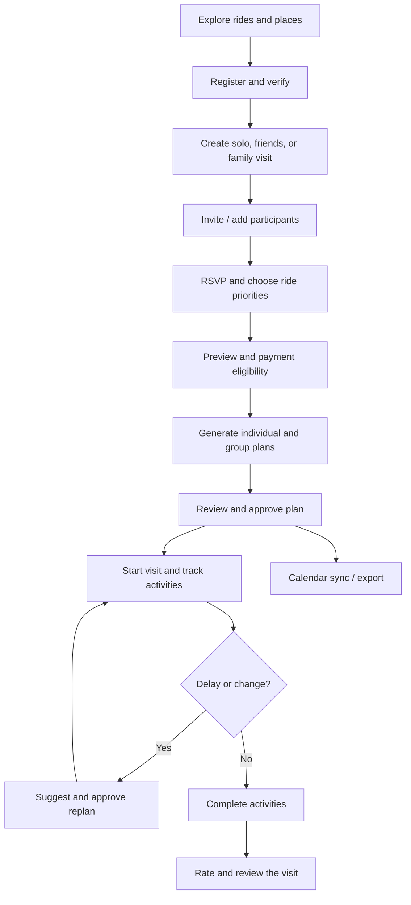
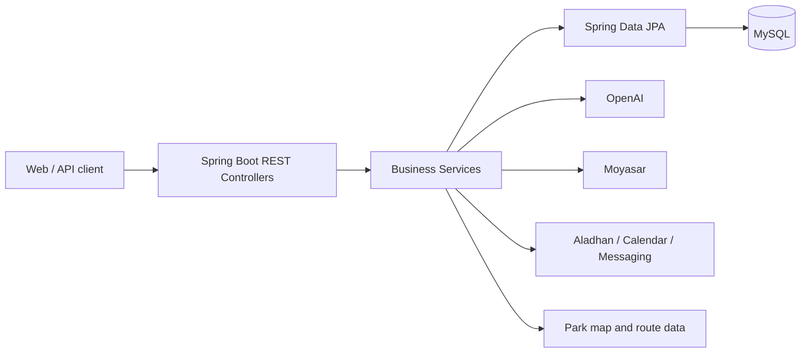

<div align="center">


# SIKKA | سكة 🎢

### Your Qiddiya day, planned in minutes.

**An AI-powered visit planner for Six Flags Qiddiya — built for solo visitors, friends, and families.**

[](https://www.java.com/)
[](https://spring.io/projects/spring-boot)
[](https://www.mysql.com/)
[](https://railway.com/)

[Overview](#overview) · [Features](#features) · [User Journey](#user-journey) · [Architecture](#architecture) · [API Overview](#api-overview) · [Contributions](#abdulaziz-shafae-contributions)

</div>

---

## Overview

**SIKKA (سكة)** helps visitors organize a full day at **Six Flags Qiddiya**. Instead of managing ride choices, queue times, walking distances, meals, and group decisions in separate places, Sikka brings them together in a coordinated visit plan.

The organizer creates a visit; friends or family participate and select rides; the backend checks ride restrictions; AI assists with individual and group itineraries; and the app supports approvals, progress tracking, GPS-assisted activities, alerts, and post-visit ratings.

> **Scope:** Sikka plans park visits. It does **not** sell Six Flags admission tickets. Paid functionality refers to Sikka's planning service.

## The Problem & Our Solution

| Visitor challenge | Sikka's approach |
|---|---|
| Different interests and ride restrictions | Personal profiles, ride priorities, and eligibility checks |
| Difficult group coordination | Solo, friends, and family visits; invitations and participant management |
| Time lost to queues and walking | Itineraries informed by available waiting-time and map data |
| Meal and prayer breaks are overlooked | Scheduled dining breaks and prayer times |
| Schedules become outdated during the visit | Completion tracking, delays, and proposed replanning |
| Hard to recall what was completed | Per-member records, ratings, and progress summaries |

## Technology Stack

| Layer | Technologies / integrations |
|---|---|
| Backend | Java 17, Spring Boot 4.1.1, REST controllers |
| Persistence | MySQL 8, Spring Data JPA / Hibernate |
| Authentication | Spring Security, session authentication, BCrypt |
| AI planning | OpenAI API, server-side itinerary validation |
| Park data & maps | Ride / place catalogue, park map and walking routes |
| Prayer times | Aladhan API |
| Payments | Moyasar sandbox, backend-side payment verification |
| Communication | Gmail SMTP, UltraMsg WhatsApp, n8n webhooks |
| Calendar | Google Calendar OAuth, manual Google link, Apple `.ics` export |
| QR invitations | ZXing |
| Frontend (separate repository) | Next.js 16, React 19, TypeScript, Tailwind CSS |
| Testing & delivery | JUnit, Mockito, Maven Wrapper, Docker, GitHub Actions, Railway |

**Repository scope:** This repository contains the Spring Boot backend. Do not assume a React frontend is included in this repository or that every external integration is live in production.

## External APIs & Integrations

| Service | Purpose | Implementation area |
|---|---|---|
| OpenAI API | AI-assisted individual/group plans and replanning | Planning services |
| Aladhan API | Prayer time lookup for scheduling | `PrayerTimeService` |
| Google Calendar API | OAuth connection and synchronization of approved plans | Calendar services |
| Gmail SMTP | Email verification and account messages | Email services |
| UltraMsg (WhatsApp) | Phone verification and messages | WhatsApp services |
| Moyasar API | Server-side payment confirmation | `MoyasarService` |
| n8n webhooks | Workflow-driven notification delivery | `N8nNotificationService` |

Apple Calendar `.ics` exports, ZXing QR generation, browser GPS and local park routing are **not separate external REST API providers**. Provider setup and actual live delivery depend on credentials and deployment configuration.

## Features

### Accounts, profiles and group visits
- Account registration, email and optional phone verification, password recovery, authenticated profile management.
- Visit types: `SOLO`, `FRIENDS`, and `FAMILY`.
- Invitations through a code, QR code, or shareable link; RSVP and selected ride priorities.
- Family member profiles managed by the visit organizer.
- Free-visit allowance and server-verified payment for additional planning.

### AI-assisted planning
- Individual and coordinated group itineraries.
- Three ride priorities: `MUST_RIDE`, `PREFERRED`, `OPTIONAL`.
- Eligibility and itinerary constraints evaluated by the backend — AI output is not a substitute for official ride safety rules.
- Ride availability, waiting times, walking routes, meals, snacks, and prayer-time considerations.
- Plan approval, subgroup coordination, meeting points, and proposed replanning.

### During and after the visit
- Activity sessions started manually or through GPS-assisted flows.
- Family activity completion and per-member visit records.
- Delay notifications, current / next activities, and visit progress.
- Optional ratings and reviews for completed experiences.
- Calendar synchronization and export.

## User Journey



## Architecture



The Java code follows the project structure:

```text
src/main/java/com/example/sikka/
├── Advice/       # Exception handling
├── Api/          # Common API response / exception
├── Config/       # Security and configuration
├── Controller/   # REST endpoints
├── DtoIn/        # Request DTOs
├── DtoOut/       # Response DTOs
├── Model/        # JPA entities
├── Repository/   # Database access
└── Service/      # Business logic and integrations
```

## API Overview

The backend currently declares **170 REST endpoints across 22 controllers** on the GitHub `main` branch (28 October 2026). These are source-code route counts, not a claim that every external integration has passed live end-to-end testing.

**Contribution accounting:** Each Model belongs to its original Git creator. Each API endpoint is credited to the developer who first implemented that route, even when it appears in another team member's Controller. Subsequent shared fixes and integrations are listed separately; contributor-specific endpoint totals will be published only after the route-level Git audit is complete.

## Data Model

The project currently contains **22 JPA models** across the following areas.

The project contains core models for visitors, visits, plans, park facilities, payments, messaging, and calendar sync. Examples include:

| Domain | Models |
|---|---|
| Users & visits | `Account`, `VisitorProfile`, `FamilyMember`, `Visit`, `VisitGroup`, `VisitMember` |
| Planning | `VisitPlan`, `PlanItem`, `PlanApproval`, `PlanHistory`, `VisitMealBreak` |
| Live execution | `ActivitySession`, `VisitRecord`, `Notification` |
| Park & billing | `Ride`, `Place`, `RidePreference`, `PaymentOrder`, `PrivacyConsent` |
| Calendar integration | `GoogleCalendarConnection`, `GoogleCalendarEvent`, `GoogleCalendarOAuthState` |

The current model inventory extends beyond the original **15-model team allocation**. Always use the `Model/` package for the current entity inventory rather than relying on the older ERD alone.


**Important:** The counts below are grouped by the original Model creator / Controller domain. This does not establish per-person authorship of every route; a route belongs to whoever first introduced it in Git. Such individual counts are not yet fully audited.

## Mohammed Turki Contributions

**Core entities:** Account, VisitorProfile, VisitGroup, Visit, VisitMember. FamilyMember workflows are used in this flow, but Nawaf originally created that Model.

**Main work:** registration and account/profile management, email and phone verification, password recovery, individual/friends/family visit creation, group invitations, RSVP, ride selections, visit preview, check-in, and visit lifecycle management.

**Integrations:** Gmail SMTP for email verification, UltraMsg for WhatsApp verification and ZXing for invitation QR codes. The before-visit workflow uses verified payment status supplied by the payment module.

**Additional contributions:** session-security configuration, account and visit validation, frontend-facing visit contracts, and flow-level tests. Work shared across modules is not independently attributed here.


**Controller-domain inventory:** 6 controllers and 59 endpoints in the current `main` branch. This is not a personal-code-credit count.

**Shared work note:** Several visit and member endpoints were introduced by Abdulaziz in Controllers associated with Mohammed’s models. Model ownership is kept separate from endpoint authorship.

---

<div align="center">

**SIKKA | سكة** · Your Qiddiya day, planned in minutes.

</div>
